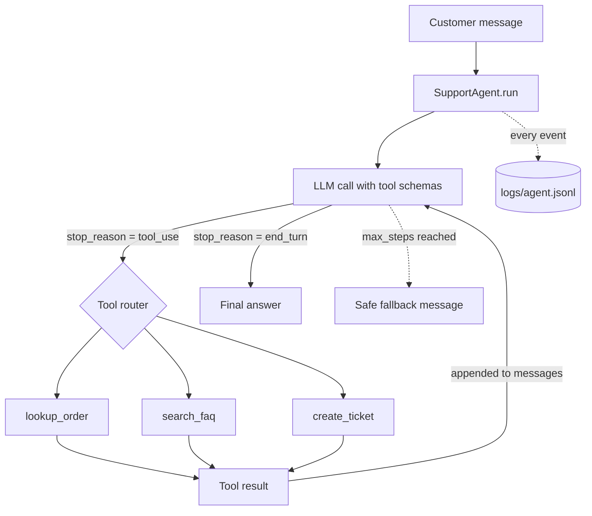

# Customer Support Agent (LLM tool calling)

A small AI agent that answers customer-support questions by deciding which tool to call: order lookup, FAQ search, or ticket creation. It uses a plain tool-calling loop on the Groq Chat Completions API, with no agent framework, so every step is visible and testable.

## Architecture



**How the loop works**

1. The user message and tool schemas go to the model.
2. If the model asks for a tool, we run it, log the call and result, and send the result back.
3. This repeats until the model answers in plain text, or `max_steps` is hit (a guard against infinite loops).
4. Tool errors are returned to the model as `is_error` results instead of crashing the loop.

## Tools

| Tool | Purpose | Data source |
|---|---|---|
| `lookup_order` | Status, tracking, delivery date | `data/orders.json` |
| `search_faq` | Return, refund, shipping, warranty policies | `data/faq.json` |
| `create_ticket` | Escalate to a human | writes `data/tickets.json` |

## Logging

Every event (`user_message`, `tool_call`, `tool_result`, `final_answer`, `step_limit_reached`) is printed to the console and appended to `logs/agent.jsonl`, tagged with a `run_id`. Example:

```json
{"ts": "2026-11-07T03:10:12+00:00", "event": "tool_call", "run_id": "a1b2c3d4", "step": 1, "tool": "lookup_order", "arguments": {"order_id": "ORD-1001"}}
```

## Setup

```bash
python -m venv .venv
.venv\Scripts\Activate.ps1    # Windows PowerShell
pip install -r requirements.txt
Copy-Item .env.example .env       # then put your GROQ_API_KEY in .env
```

## Run

```bash
pytest -q                        # tests use a fake client, no API key needed
python cli.py                    # chat in the terminal
streamlit run app.py             # chat in the browser
```

Try these prompts:

- `Where is order ORD-1001?`
- `What is your return policy?`
- `My keyboard from ORD-1002 arrived broken. My email is ravi@example.com`

## Tests

- `tests/test_tools.py`: each tool, input validation, error handling
- `tests/test_agent.py`: loop behaviour with a scripted fake LLM (tool call then answer, logging order, error recovery, step limit, multi-turn history)

## What I learned / limitations

- Returning tool errors to the model (instead of raising) lets it recover or apologise gracefully.
- A `max_steps` cap is essential; a looping model can otherwise burn tokens.
- FAQ search is keyword overlap. Swapping it for embeddings plus a vector database is the natural next step (this is where my RAG project plugs in).
- Orders and tickets are JSON files; a real system would use a database and authentication before showing order details.

## Project layout

```
agent/        agent loop, tools, logger
data/         sample orders and FAQ
tests/        pytest suite
app.py        Streamlit UI
cli.py        terminal chat
```
